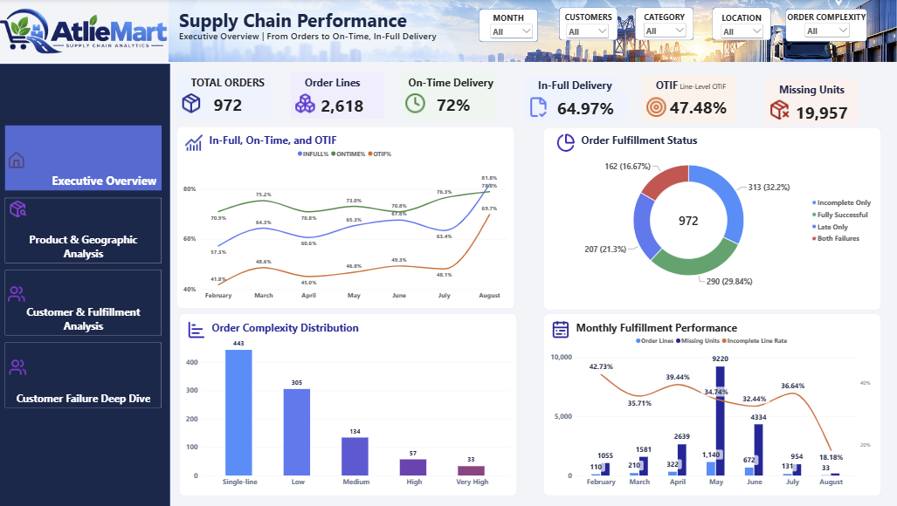
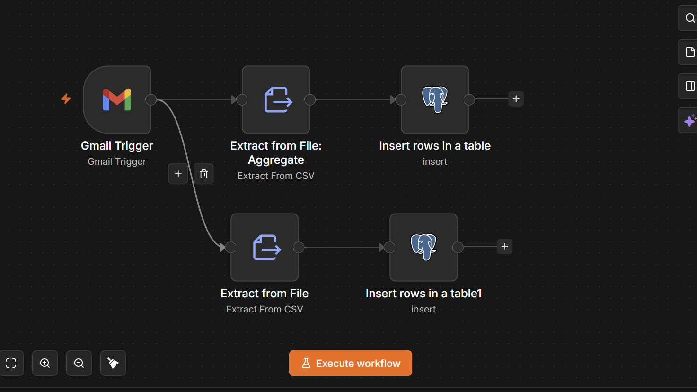
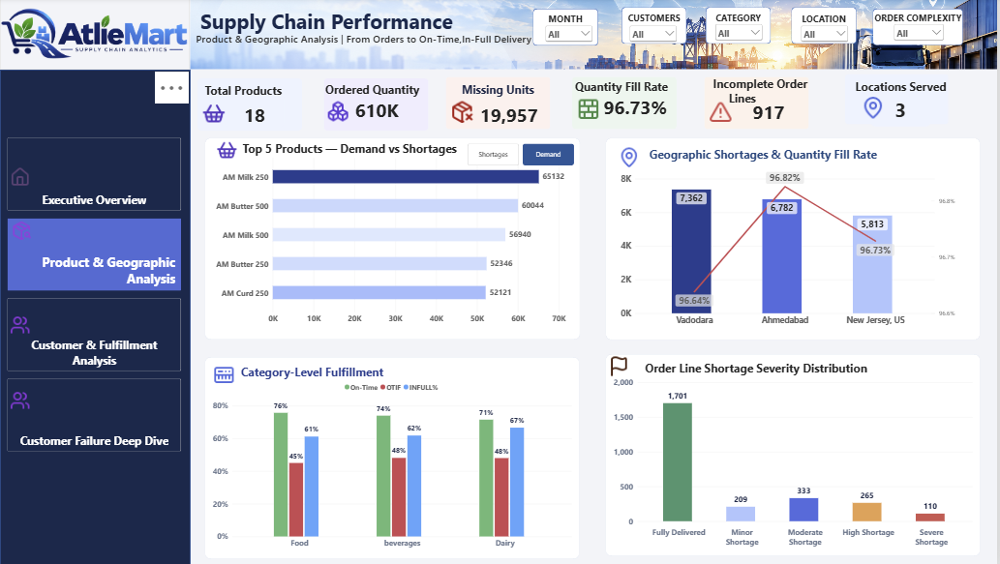
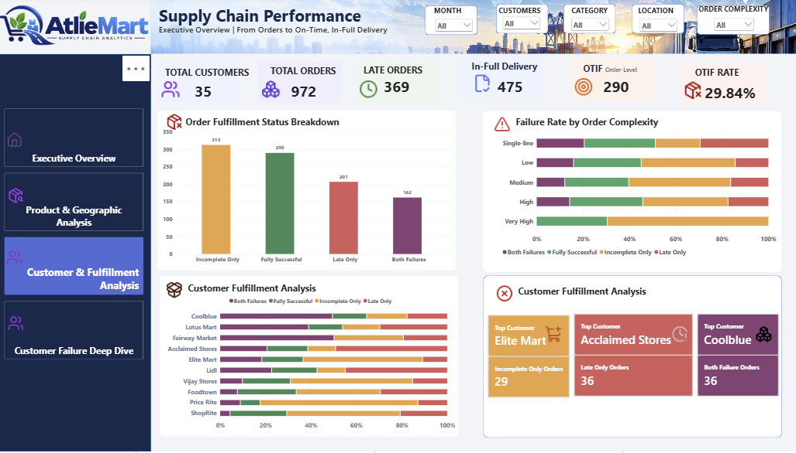
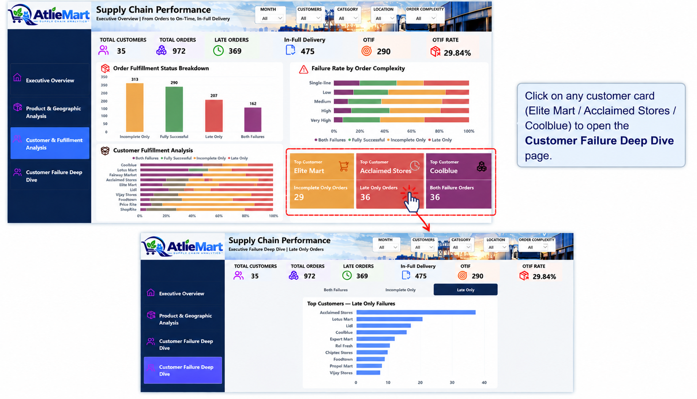
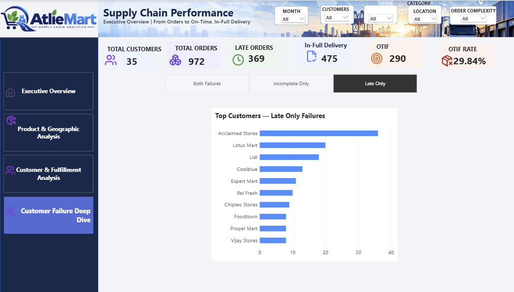

[README (4).md](https://github.com/user-attachments/files/34038128/README.4.md)
# Atlie Mart | Supply Chain Analytics & Data Automation

**An end-to-end supply chain analytics portfolio project using n8n, Supabase PostgreSQL, and Microsoft Power BI.**

This project examines why Atlie Mart's order fulfillment performance falls short of expectations, identifies the operational drivers of low **On-Time In-Full (OTIF)** performance, and presents interactive dashboards for monitoring delivery reliability, product shortages, and customer-level fulfillment failures.

> **Core finding:** Incomplete deliveries are a larger contributor to fulfillment failure than late-only deliveries. This creates a meaningful risk to customer experience. Customer dissatisfaction is a business implication, **not a directly measured outcome**, because the dataset does not include customer feedback or satisfaction scores.

## 1. Business problem

A retailer can deliver an order on time and still disappoint its customer if products or quantities are missing. Tracking delivery timeliness alone therefore gives an incomplete view of supply chain performance.

Atlie Mart needed to answer:

- How many orders and order lines meet both on-time and in-full requirements?
- Are delivery delays or incomplete quantities the more significant source of OTIF failure?
- Which products, categories, locations, and customers experience the greatest shortages?
- Does order complexity affect fulfillment outcomes?
- How can operational data be made available for analysis with less repetitive manual handling?

### How the problem was identified

The investigation started with a broad **OTIF performance gap** rather than assuming its cause. The analysis separated two distinct requirements—**on-time delivery** and **in-full delivery**—then examined missing quantities and classified each order into mutually exclusive fulfillment outcomes:

1. Fully Successful
2. Incomplete Only
3. Late Only
4. Both Failures (late and incomplete)

Comparing these categories showed that incomplete fulfillment was a more prevalent issue than late-only delivery. Product, geographic, and customer analyses were then used to explore where shortages were concentrated and which customer accounts were most exposed. The geographic view also indicated greater incomplete-fulfillment exposure in the Indian region than in the US region, a particularly important finding because the company is based in India.

## 2. Solution overview

The solution combines data-ingestion automation, centralized relational storage, and interactive business intelligence.


**Architecture:** Email → n8n → Supabase PostgreSQL → SQL analysis → Power BI.

### End-to-end data journey


*Conceptual architecture illustration; sample email, database interface, SQL snippets, and sample values in the illustration are illustrative, not evidence of executed queries or actual email contents. The real workflow and dashboard are shown separately below.*

| Stage | Data entering the stage | What happens to the data | Data leaving the stage |
|---|---|---|---|
| **1. Email (Gmail)** | CSV attachments containing operational order records | New email with attachment is detected | Original CSV file content |
| **2. n8n workflow** | CSV attachment data | Gmail Trigger starts two extraction branches; each **Extract from File** node parses CSV records, and each PostgreSQL **Insert rows in a table** node sends records for insertion | Parsed CSV fields passed as database rows |
| **3. Supabase PostgreSQL** | Inserted operational rows | Data is stored in structured relational tables, supporting queries and consistent field types | Queryable order-line and dimension data |
| **4. SQL analysis in PostgreSQL** | Stored tables | SQL is used to explore and validate records, aggregate orders and shortages, and investigate on-time/in-full performance | Analytical findings and validated data definitions |
| **5. Power BI** | PostgreSQL data | Data model relationships, DAX measures, slicers, and visuals turn records into metrics and comparisons | Four interactive dashboard pages and business insights |

**Important distinction:** The supplied n8n screenshot demonstrates CSV extraction and PostgreSQL insertion nodes; it does **not** by itself demonstrate cleaning, deduplication, validation rules, or successful scheduled execution. Those operations should only be claimed if separately implemented and verified.

### Database and SQL investigation

Supabase was used not only as a PostgreSQL storage layer but also as a place to conduct **SQL-based exploration and analysis**. Queries can support order-level aggregation, validation of missing quantities, comparisons of failure categories, and investigation of regional fulfillment differences. Add actual, reviewed SQL scripts to `sql/analysis_queries.sql` to make this work reproducible. Do not treat the illustrative SQL in the architecture image as an executed project query.

### Power BI executive overview — actual dashboard




**Actual n8n workflow screenshot:**



The workflow starts with a **Gmail Trigger** and branches into two CSV extraction paths. Each path uses an **Extract from File** node and a PostgreSQL **Insert rows in a table** node to load the extracted records into the database. The two branches support separate CSV-to-table ingestion paths; the screenshot does not establish their specific destination table names or successful execution.

After ingestion, Supabase PostgreSQL provides the central data source for the Power BI analytical model and dashboard.


- **n8n:** Email-triggered ingestion workflow intended to reduce repeated file downloads, preparation, and manual database uploads.
- **Supabase PostgreSQL:** Central storage for operational order, customer, product, and delivery data.
- **Power BI:** Direct database connectivity for loading and modeling data, DAX-based KPIs, and interactive dashboard reporting.

**Implementation note:** The architecture illustrates the project's intended end-to-end flow. Confirm that the email-triggered n8n ingestion executed successfully before describing it as a fully deployed or production-tested automation. Power BI's connection to Supabase PostgreSQL should not be confused with Power BI *DirectQuery* mode; the connection mode must be documented according to the actual PBIX configuration.

## 3. Tools and skills

| Technology | Role |
|---|---|
| n8n | Email-triggered workflow and automated data ingestion |
| Supabase PostgreSQL | Relational data storage and query layer |
| SQL | Data exploration, validation, and business logic |
| Microsoft Power BI | Data modeling, DAX calculations, visualizations, bookmarks, and drill-down analysis |
| GitHub | Project documentation and portfolio presentation |

## 4. Data and analytical model

The dashboard analyzes:

| Metric | Value |
|---|---:|
| Unique orders | **972** |
| Order lines | **2,618** |
| Customers | **35** |
| Products | **18** |
| Missing units | **19,957** |

Core analytical tables:

- `fact_order_line_rows` — order-line quantities, delivery quantities, delivery status, product, customer, and price information.
- `Order_Complexity` — one record per order, with order complexity and mutually exclusive fulfillment status.
- `dim_customers_rows` — customer attributes and city.
- `dim_products_rows` — product attributes and categories.
- `date_table` — date-based analysis.

**Metric grain matters:** Order-line OTIF and order-level OTIF answer different questions. They should not be interpreted as interchangeable percentages.

## 5. KPI definitions and baseline performance

| KPI | Result | Interpretation |
|---|---:|---|
| On-time delivery | **72.00%** | Reported on-time delivery performance |
| In-full delivery | **64.97%** | Reported complete-quantity delivery performance |
| **Line-level OTIF** | **47.48%** | Share of order lines meeting both requirements |
| **Order-level OTIF** | **29.84%** | Share of complete orders classified as fully successful |
| Orders with late deliveries | **369** | Orders affected by lateness, including combined failures |
| Orders with incomplete deliveries | **475** | Orders affected by incompleteness, including combined failures |
| Fully successful orders | **290** | Orders meeting both requirements |

**Line-level OTIF DAX:**

```dax
OTIF% =
DIVIDE(
    CALCULATE(
        COUNTROWS(fact_order_line_rows),
        fact_order_line_rows[On_Time_In_Full] = 1
    ),
    [Order_lines]
)
```

Here, `[Order_lines] = COUNTROWS(fact_order_line_rows)`.

**Order-level OTIF:** 290 fully successful orders ÷ 972 orders ≈ **29.84%**.

## 6. Root-cause investigation: Why is OTIF low?

To distinguish delay from quantity shortfalls, the analysis split the **972 orders** into four mutually exclusive outcomes:

| Fulfillment outcome | Orders | Share of all orders |
|---|---:|---:|
| Fully Successful | 290 | 29.84% |
| **Incomplete Only** | **313** | **32.20%** |
| Late Only | 207 | 21.30% |
| Both Failures | 162 | 16.67% |
| **Total** | **972** | **100%** |

### What the evidence shows

- **475 orders (48.87%)** were incomplete: 313 *Incomplete Only* + 162 *Both Failures*.
- **369 orders (37.96%)** were late: 207 *Late Only* + 162 *Both Failures*.
- **313 orders** failed because of incompleteness alone, compared with **207 orders** that failed because of lateness alone.
- Incomplete deliveries affected **106 more orders** than late deliveries, when each failure type is counted inclusively (475 versus 369).
- **19,957 missing units** indicate a material fulfillment quantity gap requiring product- and location-level investigation.

**Conclusion:** The observed fulfillment data supports prioritizing **order completeness** as a major driver of low order-level OTIF. Delivery timeliness also matters, and the 162 orders with both failure types require combined interventions. The analysis identifies associations and failure patterns, not a proven causal explanation for why shortages occur.

### Customer experience implication

Incomplete orders can result in unmet customer expectations, additional service requests, re-deliveries, and potential repeat-purchase risk. These are **plausible business consequences**, not measured customer dissatisfaction: this dataset contains no satisfaction survey, complaint, churn, or retention metric.

## 7. Power BI dashboard walkthrough

### Page 1 — Executive Overview


High-level order and order-line KPIs, delivery performance, missing units, monthly trends, and fulfillment status distribution. This page helps stakeholders recognize the overall OTIF gap quickly.

### Page 2 — Product & Geographic Analysis



Product demand versus shortages, category-level fulfillment, geographic concentration of missing quantities, and severity analysis. A **Demand / Shortages** bookmark navigator lets users switch analytical perspectives without adding another report page.

### Page 3 — Customer & Fulfillment Analysis



Customer exposure to incomplete, late, and combined failures; order-complexity patterns; and top affected customers. Interactive summary cards provide navigation to deeper customer-level investigation.


### Interactive Customer Failure Navigation

The Customer & Fulfillment Analysis dashboard includes three interactive customer cards:

- **Elite Mart:** Incomplete Only — 29 orders
- **Acclaimed Stores:** Late Only — 36 orders
- **Coolblue:** Both Failures — 36 orders

Clicking any of these cards navigates to the Customer Failure Deep Dive page, automatically selecting the corresponding failure category using Power BI bookmarks.



This feature enables users to move directly from high-level customer insights to detailed failure analysis without manually adjusting filters.


### Page 4 — Customer Failure Deep Dive



A selectable view of **Both Failures**, **Incomplete Only**, and **Late Only**, with a dynamic customer ranking, category-specific titles, and contextual tooltips. Top-10 rankings can display more than 10 customers when values are tied.

> **Screenshot guidance:** Export one clear screenshot per page at a consistent resolution, with readable labels and the intended default filters. Add the four images at the exact paths shown above so GitHub renders them automatically.

### Geographic finding — India versus the US

The geographic analysis indicates that **incomplete fulfillment is more prevalent in the Indian region than in the US region**, despite Atlie Mart being based in India. This makes domestic order completeness a priority for operational investigation: proximity to the company's home market does not necessarily translate into better fulfillment outcomes.

**Business implication:** Review domestic inventory allocation, stock availability, warehouse picking and packing, and dispatch processes to identify why Indian orders experience greater incompleteness. Prioritize high-shortage Indian locations for corrective action and monitor whether the gap narrows over time.

**Interpretation note:** The comparison is an observed dashboard pattern, not proof that the company's location causes the difference. For a fair geographic comparison, distinguish absolute missing units or incomplete-order counts from **incomplete-order rates** (incomplete orders divided by total orders in each region); higher Indian order volume alone can produce higher counts.

## 8. Customer-level findings

Examples highlighted in the dashboard include:

- **Elite Mart:** 29 orders in the *Incomplete Only* category.
- **Acclaimed Stores:** 36 orders in the *Late Only* category.
- **Coolblue:** 36 orders in the *Both Failures* category.

These customer-level counts help prioritize operational investigation and account-specific follow-up. They do not by themselves establish customer dissatisfaction.

## 9. Recommendations

1. **Prioritize order completeness.** Track incomplete orders and missing units alongside timeliness, rather than focusing exclusively on late deliveries.
2. **Prioritize Indian-region incompleteness.** Investigate the observed India–US gap, compare region-normalized incomplete-order rates, and audit domestic stock availability, picking, packing, and allocation. Use product, category, and city views to identify recurring quantity shortfalls.
3. **Target the most affected customers.** Review high-failure accounts and coordinate corrective action with fulfillment and customer-facing teams.
4. **Separate failure types operationally.** Differentiate incomplete-only, late-only, and combined failures to avoid one-size-fits-all interventions.
5. **Monitor order complexity.** Check whether multi-line or complex orders are associated with higher failure rates and test process improvements accordingly.
6. **Track improvement over time.** Monitor order-level OTIF, line-level OTIF, incomplete-order rate, and missing units after operational changes.

## 10. Potential business value of automation

Automating email-based ingestion and centralizing data can reduce repetitive file handling, improve consistency, and make operational reporting easier to maintain.

The following figures are **illustrative improvement targets**, not measured project outcomes:

| Area | Illustrative target | Potential business value |
|---|---:|---|
| Manual data handling | Up to **80% less** | Fewer repetitive download/upload steps |
| Data ingestion time | Up to **75% faster** | Quicker availability of new operational data |
| Processing throughput | Up to **4×** | More records handled per unit of staff time |
| Report preparation | Up to **60% faster** | Less manual preparation before analysis |
| Data consistency | Qualitative improvement | More repeatable ingestion and centralized storage |
| Decision support | Qualitative improvement | Faster identification of fulfillment issues |

**Measurement plan:** To validate these targets, compare manual and automated runs on the same representative email files and record elapsed time, operator touch time, rows processed, ingestion failures, and data-quality exceptions.

## 11. Repository structure and image gallery

```text
atlie-mart-supply-chain-analytics/
├── README.md
├── Atlie_Mart_Supply_Chain.pbix            
├── architecture/
│   └── 01_End_to_End_Data_Journey_Illustration.png
├── screenshots/
│   ├── 01_Executive_Overview.png            
│   ├── 02_Product_Geographic.png             
│   ├── 03_Customer_Fulfillment.png           
│   ├── 04_Customer_Failure_Deep_Dive.png     
│   ├── 05_Data_Model.png                     
│   ├── 06_n8n_Workflow.png                   
│   └── 07_Supabase_SQL_Analysis.png          
```

**Already included in this repository package:** your actual Power BI Executive Overview screenshot, your actual n8n workflow screenshot, and an *illustrative* data journey graphic.

**Still to add:** the other three dashboard screenshots, a Power BI model-view screenshot, a Supabase SQL Editor screenshot, the final PBIX, and any SQL or n8n exports you want to share. Image links to the remaining screenshots will render once the corresponding files are added.

**Screenshot safety:** Redact email addresses, project identifiers, credentials, API keys, tokens, and private operational data before publishing. The conceptual diagram contains illustrative values and should be labeled as such.

## 12. How to explore the project

1. Review the four dashboard screenshots above for a quick visual tour.
2. Open `Atlie_Mart_Supply_Chain.pbix` in Power BI Desktop if the file is included.
3. Explore filters for month, customer, product category, location, and order complexity.
4. Compare the line-level and order-level OTIF KPIs, then inspect the customer failure categories.
5. Use the Demand / Shortages bookmarks and the customer deep-dive navigation to explore operational patterns.

**Reproducibility note:** The PBIX may require access to the underlying Supabase database to refresh. Do not publish database passwords, API secrets, private email content, or connection credentials. A sanitized sample dataset and setup instructions can be added if public reproducibility is desired.

## 13. Limitations and next steps

- Customer satisfaction, complaints, churn, and retention were **not directly measured**.
- Shortage patterns reveal where failures occur, but do not independently prove upstream causes such as supplier stockouts or warehouse picking errors.
- The efficiency estimates above are hypothetical until tested against a manual-process baseline.
- Future improvements could include automated ingestion monitoring, exception alerts, stock-availability data, and customer satisfaction measures.

## 14. Project takeaway

**The key operational insight is that completeness deserves greater attention.** Although delivery delays contribute to poor service, incomplete fulfillment affected more orders than lateness and was the larger standalone failure category. Combining an email-to-database workflow with Supabase and Power BI creates a practical foundation for tracking these issues, prioritizing interventions, and measuring improvements over time.
